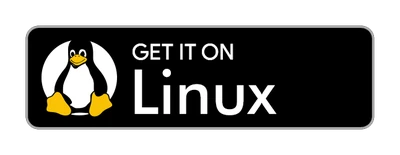
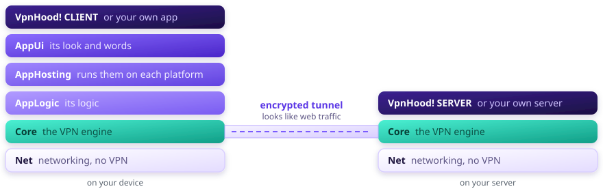

#  VpnHood!

An open-source VPN, from the engine to the apps and the server, written in C# on .NET. It resists deep packet
inspection: it looks like ordinary browsing, for more privacy.

[](https://github.com/vpnhood/VpnHood/releases/latest)
[](https://www.nuget.org/packages/VpnHood.Core.Client)
[](LICENSE)
[](https://www.vpnhood.com/security-audit/)
[](https://www.linkedin.com/company/vpnhood)
[](https://www.facebook.com/vpnhood)
[](https://www.instagram.com/vpnhood)
[](https://x.com/vpnhood)

[Website](https://www.vpnhood.com) · [Developer site](https://developer.vpnhood.com) · [Features](#features) ·
[Get started](#get-started) · [Inside the repository](#inside-this-repository) · [Changelog](CHANGELOG.md)

## Get VpnHood! CLIENT

<a href="https://play.google.com/store/apps/details?id=com.vpnhood.client.android"></a>
<a href="https://apps.apple.com/app/id6788176050"></a>
<a href="https://github.com/vpnhood/VpnHood/releases/latest/download/VpnHoodClient-win-x64.exe"></a>
<a href="download/vpnhood-client.md#linux"></a>

For Android and Android TV, iPhone, iPad and Apple TV, Windows and Linux. [All downloads](download/vpnhood-client.md),
the APK from GitHub and IzzyOnDroid included.

## How it fits together



Each layer is a set of NuGet packages that builds only on the layers under it, through contracts. Take only the parts
you need, or replace any of them: your own look, your own host, your own ads and billing, another VPN engine under the
same app, or your own access manager behind the server. Net knows nothing of a VPN, so any .NET app can use it.

[VpnHood Client Architecture](https://developer.vpnhood.com/articles/client-architecture.html), on the developer site,
goes through each layer and the contracts between them.

## Features

### In the apps

- **Cloak Mode:** VPN traffic looks like ordinary web traffic, so a network can hardly tell you use a VPN.
- **Protocols:** UDP, TCP and QUIC, to suit the network you are on, over IPv4 and IPv6.
- **Smart Proxies:** paste a proxy list, and the app tests, rates and rotates the proxies it reaches the server through.
- **Split tunneling:** by country, domain, IP address or local network, and by app on Android. Domains are found in
  both web and QUIC traffic, and a change applies without reconnecting.
- **No DNS leaks:** pick the DNS servers the tunnel uses; DNS stays in the tunnel even for traffic you split out of
  it, and IPv6 that the server cannot carry is blocked, not leaked.
- **A Kill Switch that holds:** on Windows and Linux the block stays through a crash of the app and a restart of the
  computer, and Lockdown keeps it after you disconnect. Android uses its own system setting.
- **Always On:** on Windows and Linux the VPN connects at boot, before anyone signs in.
- **Reconnects by itself:** after a network change, or when your server moves to a new address.
- **Smooth under load:** a big upload does not stall your browsing, and games that send large packets work.
- **Command line:** on Windows and Linux, connect, follow the status as JSON, and manage profiles and locations, on a
  machine with no desktop too.
- **Diagnose:** checks the network, DNS and the server to tell which one is at fault, and sends a report if you choose.
- **Updates itself:** the builds from GitHub too, on Windows, Linux and Android.
- **On your TV:** Apple TV and Android TV, set up from your phone.
- **For everyone:** 13 languages, and screen readers.

### In the server

- **One command:** installs it on Linux (x64 or ARM64), Windows or Docker, and keeps it up to date.
- **Standalone or managed:** a server keeps its access keys in files, or asks an access manager of your own over
  HTTP.
- **Keeps its machine patched:** with `-osupdate`, the operating system installs its security fixes every night and
  restarts when a fix needs it, each server at a time of its own, so the servers of a farm seldom restart together.
- **Steady sessions:** connected devices stay connected through a restart of the server or its machine.
- **Looks like a web server:** to anyone without an access key, it answers as an ordinary web server would, and the
  name on its certificate follows no pattern that a network could match.
- **No domain needed:** an access key carries the fingerprint of the server's own certificate.
- **Hard to block:** separate addresses for connecting and for going out, reverse proxies such as Cloudflare, and
  [settings for a censored network](https://www.vpnhood.com/vpnhood-server/docs/ip-blocking/).
- **Guards against abuse:** blocks the mail port, limits each user's DNS and new connections, keeps users from
  reaching each other, and refuses the server's own and local addresses.
- **Access keys with limits:** the number of devices, the traffic, the speed and an expiry date, from the command line.
- **No logs of your users:** it does not log your users' IP addresses or the places they visit, and it anonymizes the
  rest of its logs.
- **Tunes its machine:** on Linux it sizes the connection table for a busy server, and can turn on BBR and add a
  swap file.
- **Recovers on its own:** it restarts its network adapter after a network change, and cleans up after a crash.

### For developers

- **All C#:** everything in this repository is C# on .NET 11, open source under the LGPL 2.1, and
  [audited](#security-audit).
- **Your own VPN app:** [VpnHood.App.Template](https://github.com/vpnhood/VpnHood.App.Template) builds a branded app
  from the NuGet packages alone, with your own name, icons and servers, on every platform.
- **Modular:** use any layer on its own, or replace any part of it, as [How it fits together](#how-it-fits-together)
  shows.
- **One codebase, every platform:** Android, iOS, tvOS, Windows and Linux, with an Avalonia UI.
- **Networking without the VPN:** a user-space TCP stack, QUIC on Android and iOS, HTTP/3 without ASP.NET Core, the
  TUN and WinDivert adapters, and IP locations offline or online, for any .NET app.
- **A server in your own code:** run a VPN server from your app, with its access keys kept in files.
- **Built for your own business:** ad networks (AdMob, InMobi, Chartboost) and store billing (Google Play and the App
  Store) plug in as providers, and a fork replaces only `src/apps/`.
- **Examples that work:** the code in the developer guides is taken from tests, and checked before each package
  release.

[All features](https://www.vpnhood.com/features/) are on the website.

## Get started

### Run your own VPN

| <a href="https://www.vpnhood.com/vpnhood-server/docs/install/linux/"></a> | <a href="https://www.vpnhood.com/vpnhood-server/docs/install/windows/"></a> |
| :---: | :---: |
| [Linux](https://www.vpnhood.com/vpnhood-server/docs/install/linux/) | [Windows](https://www.vpnhood.com/vpnhood-server/docs/install/windows/) |

[Install VpnHood! SERVER](https://www.vpnhood.com/vpnhood-server/docs/install/) with one command on Linux, Windows or Docker, then add its
access key to [VpnHood! CLIENT](download/vpnhood-client.md), on Android and Android TV, iPhone, iPad and Apple TV,
Windows or Linux.

### Build your own app

Start with [Build your VPN app](https://developer.vpnhood.com/articles/build-your-app.html) on the developer site, or
with [VpnHood.App.Template](https://github.com/vpnhood/VpnHood.App.Template), which builds a branded app from the
NuGet packages alone.

### Build from source

You need the [.NET 11 SDK](https://dotnet.microsoft.com/download). Clone the repo with its submodules, which hold the
apps' images and words, then build a head, such as the Windows app or the server:

```bash
git clone --recurse-submodules https://github.com/vpnhood/VpnHood.git
cd VpnHood
dotnet build src/apps/Client/Client.Windows.Web
dotnet build src/apps/Server
```

## Inside this repository

| Folder | What it holds |
| --- | --- |
| [`src/libs/Net`](src/libs/Net) | networking with no VPN in it: packets, a user-space TCP stack, QUIC, the TUN and WinDivert adapters, IP locations |
| [`src/libs/Core`](src/libs/Core) | the VPN engine: the tunnel, the client, the server, split tunneling and proxies |
| [`src/libs/AppLogic`](src/libs/AppLogic) | the app around the engine: its API, the app on each platform, the store and ad providers |
| [`src/libs/AppHosting`](src/libs/AppHosting) | the hosts that run a UI on each platform: a window, a page in a browser, the desktop's service |
| [`src/libs/AppUi`](src/libs/AppUi) | the user interface: the Avalonia look, its words and its assets |
| [`src/apps`](src/apps) | the apps we ship: CLIENT, CONNECT and SERVER, one head per platform and store |
| [`tests`](tests) | the tests of the libraries and the apps |
| [`docs`](docs) | the developer guides, published on [developer.vpnhood.com](https://developer.vpnhood.com) |
| [`pub`](pub) | the release scripts and the installers |

[How the source is laid out](docs/source-layout.md) goes through every folder.

## Related repositories

| Repository | What it holds |
| --- | --- |
| [VpnHood.App.Template](https://github.com/vpnhood/VpnHood.App.Template) | a white-label app template: your own VPN app from one app folder |
| [VpnHood.App.Samples](https://github.com/vpnhood/VpnHood.App.Samples) | small apps that use the engine and the app's logic |
| [VpnHood.AppUi.Assets.Classic](https://github.com/vpnhood/VpnHood.AppUi.Assets.Classic) | the app's look: images, flags, fonts and the words of every language |
| [VpnHood.App.Server](https://github.com/vpnhood/VpnHood.App.Server) | the releases of VpnHood! SERVER |
| [Vpnhood.App.Connect](https://github.com/vpnhood/Vpnhood.App.Connect) | the releases of VpnHood! CONNECT |

## Documentation

- [developer.vpnhood.com](https://developer.vpnhood.com): the guides, the samples, the libraries and the API reference
- [Self-hosted VPN docs](https://www.vpnhood.com/self-hosted-vpn/docs/): install and run VpnHood! SERVER
- Changelogs: [the apps](CHANGELOG.md), [the NuGet packages](CHANGELOG.Packages.md), [the server](CHANGELOG.Server.md)

## Security audit

Include Security audited VpnHood for the Open Technology Fund's Red Team Lab.
[Read the report](https://www.opentech.fund/security-safety-audits/vpnhood-security-audit-results/) or
[what it means for you](https://www.vpnhood.com/security-audit/).

To report a vulnerability, follow the [security policy](SECURITY.md).

## Support and community

- Questions and ideas: [GitHub Discussions](https://github.com/vpnhood/VpnHood/discussions)
- Bugs and feature requests: [GitHub Issues](https://github.com/vpnhood/VpnHood/issues)
- Email: [support@vpnhood.com](mailto:support@vpnhood.com)
- Follow us: [LinkedIn](https://www.linkedin.com/company/vpnhood), [Facebook](https://www.facebook.com/vpnhood),
  [Instagram](https://www.instagram.com/vpnhood) and [X](https://x.com/vpnhood)

Contributions, feedback and stars are welcome: [how to contribute](CONTRIBUTING.md).

## License

VpnHood is open source under the [GNU Lesser General Public License 2.1](LICENSE).

Thanks to [ReSharper](https://www.jetbrains.com/resharper/), which helps us write, improve and maintain our C# code.
