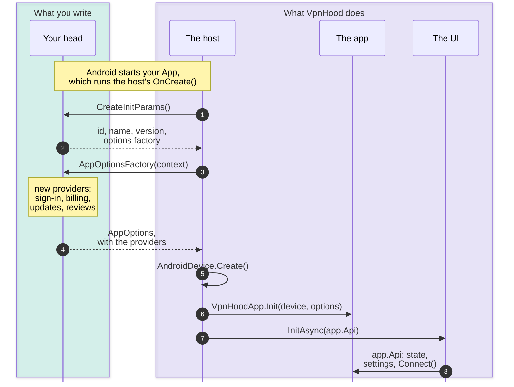
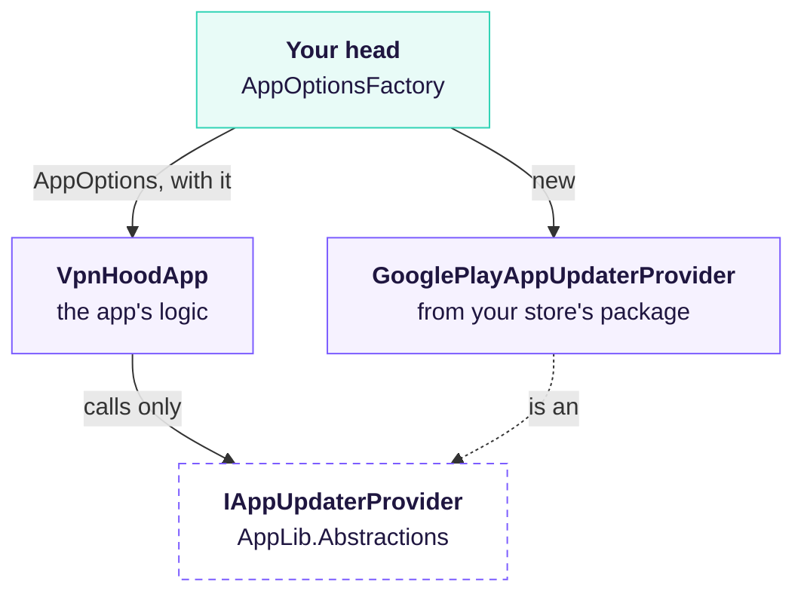

# How a VpnHood App Starts

Your app's own code is its head: one small project for each platform and store, as in
[VpnHood.App.Template](https://github.com/vpnhood/VpnHood.App.Template/tree/main/src). A head writes two
things: who the app is, and the app's options with the providers its store needs. VpnHood's host for the
platform does the rest: it makes the device, starts the app's logic with those options, and shows the UI on
the app's API.

## What starts what

On Android your head's `App` derives from the host, so Android's call that starts it runs the host, which
calls back the two methods your head writes, then builds the app:

- **Who the app is** (steps 1-2, `CreateInitParams`): its id, name and version, the name of its storage
  folder, and the factory that makes its options. The template's are in
  [`App.cs`](https://github.com/vpnhood/VpnHood.App.Template/blob/main/src/VpnApp.Android.Google/App.cs).
- **The app's options** (steps 3-4, `AppOptionsFactory`): what every build of the app says the same way -
  its settings, its access keys, its premium tier, its UI's files - and, on top, what its store decides:
  the providers below. The template keeps the shared part in
  [`VpnAppOptions.cs`](https://github.com/vpnhood/VpnHood.App.Template/blob/main/src/VpnApp/VpnAppOptions.cs),
  and each build adds its store's lines.
- **The rest is the host's** (steps 5-8): `AndroidAvaloniaApplication`, which hands this part to
  `VpnHoodAndroidApp`. It fills what your head leaves out with the platform's own (the device's UI, the
  culture), makes the device, starts the app (`VpnHoodApp.Init`), then gives the UI (`ClassicAvaloniaApp`,
  VpnHood's own, or yours) the app's API. Android starts the same `App` in the VPN service's process too,
  and there the host builds nothing. The UI reads the app through its API alone, and the app reaches the
  VPN service through the device ([VpnHood Client Architecture](client-architecture.md)).

## Giving the app its providers

What differs from store to store - sign-in, billing, updates, reviews, ads - the app's logic asks for
through interfaces of `VpnHood.AppLib.Abstractions`, and nothing else. Your head makes a class for each
from its store's package and puts it in the options; the app only ever calls the interface:

A build for another store swaps the classes and keeps the rest:

| `AppOptions` · its interface | What each build gives it |
| --- | --- |
| `AccountProvider` · `IAccountProvider` | Google Play: `PortalAccountProvider`, with `GooglePlayAuthenticationProvider` and `GooglePlayBillingProvider`. App Store: `PortalAccountProvider`, with `AppleAuthenticationProvider` and `AppStoreBillingProvider`. Windows, Linux: `PortalAccountProvider`, with the portal's own sign-in and `PortalWebBillingProvider`. |
| `UpdaterOptions.UpdaterProvider` · `IAppUpdaterProvider` | Google Play: `GooglePlayAppUpdaterProvider`. App Store: `AppStoreAppUpdaterProvider`. Windows, Linux, installed from your website: `WindowsAppUpdaterProvider`, `LinuxAppUpdaterProvider`. |
| `UserReviewProvider` · `IAppUserReviewProvider` | Google Play: `GooglePlayInAppUserReviewProvider`. App Store: `AppStoreInAppUserReviewProvider`. |
| `AdProviderItems` · `IAdProvider` | Google Play: AdMob's, from `VpnHood.AppLib.Ads.AdMob.Android`. |
| `TrackerFactories` · `ITrackerFactory` | `Ga4TrackerFactory`, except in the App Store build, which sends no analytics. |
| `DeviceUiProvider` · `IDeviceUiProvider`, `CultureProvider` · `IAppCultureProvider` | Left out: the host fills the platform's own. |

A provider your head leaves out is a feature the app goes without: no account means no sign-in and no
purchase, no updater means no update notice. The portal's account provider takes the store's sign-in and
billing, and your portal maps each store product to the plan it redeems.

## On each platform

The same two methods, under each platform's host. The VPN service runs apart, from a head of its own:

| Platform | Your app's head | Your VPN service's head |
| --- | --- | --- |
| Android | `App`, derived from `AndroidAvaloniaApplication<TUi>`, and `MainActivity`, derived from `AndroidAvaloniaMainActivity<TUi>`, which shows the UI | none: the same APK carries `AndroidVpnService`, which Android starts from the manifest |
| iOS | `AppDelegate`, derived from `IosAvaloniaAppDelegate<TUi>`, which `Main` names | the Network Extension: `PacketTunnelProvider`, derived from `IosVpnService` |
| Windows | `Main`, which calls `WindowsDesktopHost.Run(args, initParams)` | the VPN host: `Main`, which calls `WindowsVpnHost.Run(args)` |
| Linux | `Main`, which calls `LinuxDesktopHost.Run(args, initParams)` | the VPN host: `Main`, which calls `LinuxVpnHost.Run(args)` |

The host makes the platform's device: `AndroidDevice`, `IosDevice` (from the App Group and the extension's
bundle id your `IosInitParams` name), `WindowsDevice` or `LinuxDevice`. On Windows and Linux one executable
is two programs: run as the service, it makes the app with your options and serves its API; run as the
window, it shows the UI, which reads that API from the service. The VPN host is a second executable, which
the service starts at each connect ([how the desktop fits together](linux/README.md#how-it-fits-together)).

## See also

- [Build your VPN app](build-your-app.md) — the template, and what you change in it
- [VpnHood Client Architecture](client-architecture.md) — the layers, their contracts, and where each half runs
- [source-layout.md](source-layout.md#what-a-head-is-made-of) — what a head is made of
