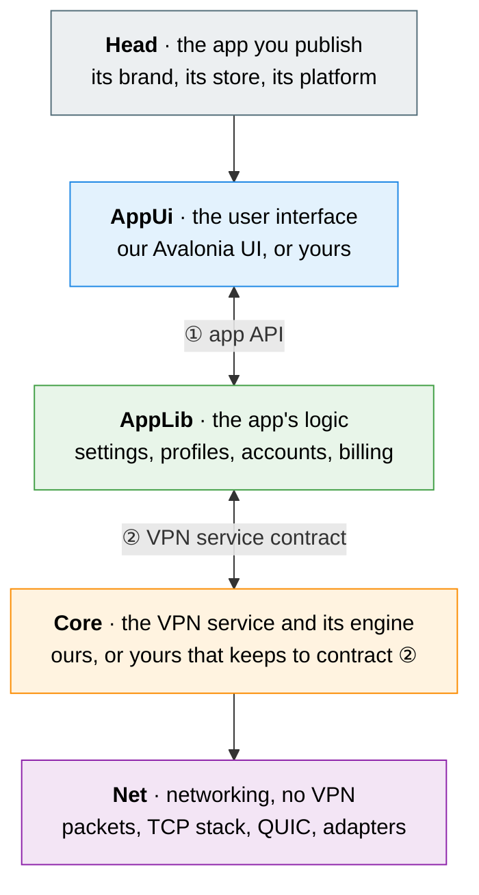

# VpnHood Client Architecture

A VpnHood client is a head - the app you publish - over three layers: the user interface, the app's
logic and the VPN engine, which meet at two contracts. Each layer can be replaced on its own: a
contract is all the layer beside it relies on.

## The layers and their contracts



1. **The head** is the app you publish, one for each platform and store: a thin shell that names the
   app and its store and hands them to its UI's host, which starts the app's logic, then the UI. Where
   the VPN service runs apart, the head carries it too: an iOS app bundles its Network Extension, a
   desktop app its VPN host. CLIENT and CONNECT are our heads; a fork writes its own
   ([what a head is made of](source-layout.md#what-a-head-is-made-of)).
2. **① The app API** is everything a UI needs from the app: six interfaces in `VpnHood.AppLib.Api` -
   the app, profiles, account, billing, intents and proxies. A .NET UI holds them as `VpnHoodApi`: the
   app's own controllers in its process (`VpnHoodApp.Api`), or the same calls over HTTP
   (`VpnHoodApiHttpFactory`), as the page a paired phone opens makes them. A UI in any other language
   makes those calls as HTTP and JSON to the app's web host.
3. **② The VPN service contract** is everything between the app and the engine: files in a folder both
   processes reach, and a few JSON requests (below). A .NET app speaks it through Core's manager and
   device (`Core.Client.VpnServices.Manager`, `Core.Client.Devices.<OS>`), which start the VPN service
   and carry the requests; an app in another language speaks it itself. The two sides share nothing
   else, not even memory in one process.

## Use any part

| To build | On our | Through |
| --- | --- | --- |
| your own branded app | AppUi, AppLib and Core | a head of your own - see [publish-your-app/](publish-your-app/README.md) |
| your own UI, in any framework or language | AppLib and Core | ① the app API |
| your own app in .NET, without AppLib | Core | the manager and the device: `Core.Client.VpnServices.Manager` and `Core.Client.Devices.<OS>` |
| your own app in another framework or language - Swift, Kotlin, C++ | Core's VPN service | ② the VPN service contract, spoken directly: our .NET device libraries are out of its reach, but the contract is plain files and JSON |
| your own VPN engine - in C++, say - under our app | AppLib and AppUi | ② the same contract from the other side: read the options, answer the requests, write the status, inside the OS's VPN component that the device starts; the head declares the engine's report (`AppOptions.VpnEngineInfo`) |
| networking for any .NET app | Net | its packages, which know nothing of a VPN |

## ② The VPN service contract

The VPN service's config folder (`IDevice.VpnServiceConfigFolder`, which both processes reach - an App
Group's on iOS) holds the files below, and the channel carries one kind of message. That is the whole
contract, and its C# types in `VpnHood.Core.Client.VpnServices.Abstractions` are its reference: an
implementation in another language writes and reads the JSON they make.

1. **The options**, `vpn.config`: JSON (`VpnServiceOptions`) saying what to connect to and how - the
   access key, the transport, the proxies - and the contract version it is written in. The app writes it
   at each connect and at each change of its settings; the VPN service reads it at each start, including
   one the OS makes on its own, and one it makes itself when a session's server has moved from the
   address its name gave: that session's end is never written to the status, which goes on with the
   new session's states.
2. **The split-tunnel rules**: SQLite databases the app publishes in two folders beside the options,
   `ip-filters` and `domain-filters`, each with a `manifest.json` naming its databases in the order they
   apply (`{ "DbFiles": [ ... ] }`), which the VPN service reads again at each reconfigure.
3. **The status**, `vpn.status`: JSON (`ConnectionInfo`) that the VPN service writes as its state
   changes, and the app reads. It carries the engine's report of itself (`VpnEngineInfo`, below).
4. **The log**, `vpn.log`: the VPN service's own.
5. **A request** is two values, each a 4-byte little-endian length followed by UTF-8 JSON: the
   request's type name (`ApiDisconnectRequest`, `ApiReconfigureRequest`, `ApiGetConnectionInfoRequest`
   and the ad's), then its body. The answer is one JSON `ApiResponse`: its result, or its error.

| Platform | The channel the requests travel |
| --- | --- |
| Windows (WinTun), Linux | TCP on loopback |
| Android | Binder transactions with the VPN service |
| iOS, tvOS | the Network Extension's provider messages (`NETunnelProviderSession`) |
| Windows, Microsoft Store | the package's app service |

### The version and the engine's report

An engine reports what it is (`VpnEngineInfo`): its name and version, the contract versions it speaks
(`MinContractVersion` to `MaxContractVersion`), and the optional features it has (`VpnEngineFeatures`: a
switch for each optional part of the contract, and the kinds of tracker it makes). The app needs that before
the engine ever runs, to offer only what it does, so the head that bundles an engine declares its report
(`AppOptions.VpnEngineInfo`, VpnHood's own engine by default); the engine writes the same in its status.

1. **The version.** The app writes the options in the highest version both sides speak
   (`ContractVersion`); with none in common the connect fails, naming both. An engine refuses options of a
   version it does not speak.
2. **The optional features.** An engine has the whole contract but these: split tunneling by app, the kill
   switch, the proxies, QUIC, the ads, always-on, the endpoint strategy and each kind of tracker. A feature
   its report leaves out is one it lacks. The app neither offers nor asks for one the engine lacks, and an
   engine asked for one fails the connect rather than ignoring it - a kill switch or a split that silently
   did nothing would leak.

A tracker crosses as its kind and its settings (`TrackerFactoryInfo`): `ga4` is GA4's own protocol, with
its measurement id, which an engine in any language can speak; `dotnet` is a factory a .NET engine makes
again from its type.

### Keeping to the contract

Every AppLib relies on the contract as it is published, so an engine that changes it breaks every app
built on it. The contract is VpnHood's, and these rules keep it stable:

1. **An engine keeps to the contract as it is.** It adds no request, field or file of its own. What it
   needs and the contract lacks is a change to the contract itself, asked for in VpnHood.
2. **The contract only grows.** A release may add a request, a field, a file or an enum's value, but
   never renames or removes one, and never changes what one means. Anything else is a new version of
   the contract.
3. **Each side ignores what it does not know.** It skips a field it does not know, reads an enum's name
   it does not know as that enum's fallback (its `JsonEnumFallback`), and answers a request it does not
   know with an error, never with silence.
4. **An engine says what it lacks.** It reports its features truly, and fails a connect that asks for one
   it does not have.

## The two halves

Every VpnHood client runs as two halves that talk over that channel: **the app** (AppUi and AppLib, with
Core's manager and device), and **the VPN service**, which holds the tunnel. On every platform they run
in separate processes, except in a developer's run. Knowing which half a type or a project belongs to
answers most "where does this go" questions.

| | The app | The VPN service |
| --- | --- | --- |
| What it does | settings, profiles, accounts, always-on, the API the UI calls | the tunnel: the session, the engine, the adapter |
| Its end of the channel | `VpnServiceManager` | `VpnServiceHost` |
| Its part of the OS | the device (`IDevice`): it starts the VPN service, opens the channel and says what the OS can do | the platform's VPN service (`<OS>VpnService`): the component the OS runs a VPN in, which makes the adapter and the channel's listener |
| Its projects | `AppLib`, `Core.Client.VpnServices.Manager`, `Core.Client.Devices.*` | `Core.Client.VpnServices.Host.*`, `Core.Client`, `Core.Tunneling` |

The two never share memory, even in one process. The manager sends requests through the device's
message client (`IMessageClient`), the VPN service answers through its listener (`IMessageListener`),
and both read the options and status files in the VPN service's folder. Each platform brings its own
transport for that channel; the desktop uses TCP on loopback.

## Where each half runs

| Platform | The app runs in | The VPN service runs in | What starts the VPN service | The VPN service's type |
| --- | --- | --- | --- | --- |
| Android | the app's process | a process of its own (Release builds) | Android, from the app's manifest | `AndroidVpnService` |
| iOS, tvOS | the app | the Network Extension | iOS, from the extension's `Info.plist` | `IosVpnService` |
| Windows, Microsoft Store | the window's process | the VPN plug-in, which Windows activates | `WindowsVpnPluginHost.Run` | `WindowsVpnPluginService` |
| Windows (WinTun) | the daemon, a Windows service; the window is its client | the VPN host, an executable the daemon starts at each connect | `WindowsVpnHost.Run` | `WindowsVpnService` |
| Linux | the daemon, a systemd unit; the window is its client | the VPN host, as on Windows | `LinuxVpnHost.Run` | `LinuxVpnService` |

The VPN service runs in the app's process in an Android Debug build, in `AvaloniaUI.Dev`, in a MAUI app
on Windows and in the tests, through the same channel. A breakpoint in the tunnel is then reached from
one debugger run. A desktop head's `dev` run starts the VPN host, as its service does.

## The projects

```text
AppLib.App.<OS>
    ├──→ AppLib.App ──→ Core.Client.VpnServices.Manager
    └──→ Core.Client.Devices.<OS>
             └──→ Core.Client.Devices.Abstractions ──→ Core.Client.VpnServices.Abstractions

Core.Client.VpnServices.Host.<OS>
    ├──→ Core.Client.Devices.<OS>
    ├──→ Core.Client.VpnServices.Host ──→ Core.Client ──→ Core.Tunneling
    └──→ Net.VpnAdapters.<OS>
```

| OS | The app's side: `Core.Client.Devices.<OS>` | The VPN service's side: `Core.Client.VpnServices.Host.<OS>` |
| --- | --- | --- |
| `Android` | `AndroidDevice`, `AndroidMessageClient` | `AndroidVpnService`, `AndroidMessageListener` |
| `Ios` | `IosDevice`, `IosMessageClient` | `IosVpnService`, `IosMessageListener` |
| `WindowsTun` | `WindowsDevice`, `WindowsVpnHostProcess` | `WindowsVpnService`, `WindowsVpnHost`, `WindowsInProcessDevice` |
| `WindowsVpnPlugin` | `WindowsVpnPluginDevice`, `WindowsVpnPluginAppServiceClient` | `WindowsVpnPluginService`, `WindowsVpnPluginHost` |
| `Linux` | `LinuxDevice`, `LinuxVpnHostProcess` | `LinuxVpnService`, `LinuxVpnHost` |

The rules the references keep:

1. **Nothing on the app's side references the VPN service's side.** AppLib, AppUi, the stores, the
   ads and every `Core.Client.Devices.*` project compile without the engine (`Core.Client`,
   `Core.Tunneling`) and without `Core.Client.VpnServices.Host.*`.
2. **`Core.Client.Devices.<OS>` is the app's half of the OS, plus what both halves share**: the VPN
   service's folders and names, the kill switch, the system logger, Android's message transport. The
   VPN service's side references it for those; nothing in it runs a tunnel.
3. **`Core.Client.VpnServices.Host.<OS>` is the OS's VPN service and its entry point**, and never
   references AppLib.
4. **The device stays in Core.** It is how an app drives the VPN service without AppLib: a
   developer's own app references `Core.Client.Devices.<OS>` and `Core.Client.VpnServices.Manager`, and
   none of AppLib.
5. **A head composes the two, and compiles against the halves it runs.** An app head references
   `AppLib.App.<OS>` and compiles against nothing of the VPN service's side: a desktop head references its
   VPN host's project marked `VhAppVpnHost`, which the build puts beside its executable
   (`VpnHood.AppUi.Hosting.Desktop.Daemon`'s targets), and an iOS head bundles its extension, both
   referenced with `ReferenceOutputAssembly="false"`. A VPN service head (an iOS extension, a VPN host,
   a VPN plug-in) references `Core.Client.VpnServices.Host.<OS>` alone. A head that runs both halves in
   one process makes both: `AvaloniaUI.Dev` and a MAUI app on Windows hand the app a
   `WindowsInProcessDevice`, and Android's head, whose one APK carries both, references both.

## Words

- **The app**: `VpnHoodApp` and what it runs. On the desktop it runs in **the daemon**, which the OS
  runs as a service - a Windows service, a systemd unit - so the desktop's commands that register and
  read it say "service" (`service install`, `service log`). "The VPN service" always means the tunnel's
  side.
- **The device**: the app's bridge to the OS (`IDevice`).
- **The VPN service**: the tunnel's side, on every platform: the OS's VPN component - Android's
  `VpnService`, iOS's packet tunnel provider, Windows' VPN plug-in, or on the desktop our own - around
  a `VpnServiceHost` and the engine.
- **The manager and the host**: the channel's two ends, `VpnServiceManager` in the app and
  `VpnServiceHost` in the VPN service.
- **The VPN host**: the executable the desktop daemon starts for the VPN service, and its entry point
  (`WindowsVpnHost`, `LinuxVpnHost`). A Store package's VPN plug-in has the same role
  (`WindowsVpnPluginHost`). On Android and iOS the OS makes that process.

## See also

- [source-layout.md](source-layout.md) — where each project lives, and what a head is made of
- [linux/README.md](linux/README.md#how-it-fits-together) — the daemon, the window and the command line on Linux
- [ios/architecture-and-ipc.md](ios/architecture-and-ipc.md) — the app and its Network Extension on iOS
