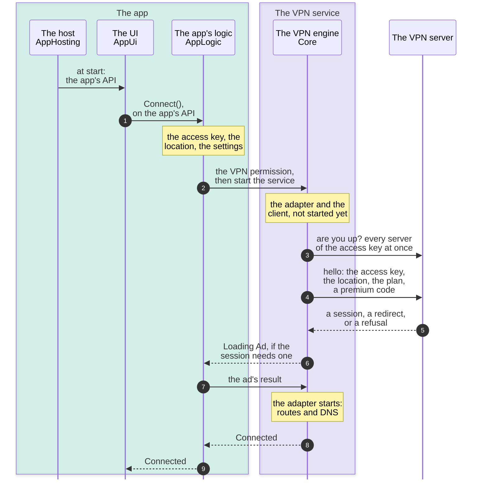

# What Happens on Connect

A tap on Connect passes through three parts: the app's logic, the VPN service with the VPN engine in it, and the
VPN server. This page follows one connect from the tap to Connected: what each step does, what the app shows
meanwhile, and what stops a connect at each step.

## From Connect to Connected

The host does its part before any connect: at start it makes the app's logic, then calls the UI and hands it the
app's API ([How a VpnHood App Starts](app-startup.md)). A connect goes from the UI to the app's logic on that API alone:
in the same process on a phone, and over HTTP on a desktop.

1. **The app gets ready** (step 1). `VpnHoodApp.Connect` ends a connect already under way, takes the selected
   profile's access key and server location, and turns the settings - split tunneling, DNS, the kill switch - into
   the VPN service's options.
2. **The VPN service starts** (step 2). The device asks the system for the VPN permission, which Android and iOS
   show in their own dialog at the first connect. Then it starts the VPN service, which reads the options and makes
   the platform's adapter and the engine's `VpnHoodClient`. The service writes its state as it goes, and the app
   reads it from there.
3. **Finding a server** (step 3). An access key names its servers: their addresses, or a host name the engine looks
   up in DNS. The engine asks all of them at once whether they are up, in a shuffled order so that clients spread
   across them, and takes one that answers. After a crash of the VPN service, it tries the server it was connected
   to first.
4. **The hello** (steps 4-5). The engine sends the server the access key's id, with proof that it holds the key, the
   location the person chose, the plan, and the profile's premium code if it has one. The server asks its access
   manager, which answers in one of three ways:
   - **A session:** its id and key, what the server carries, and whether the session needs an ad first.
   - **A redirect:** the session belongs on other servers, as in a farm with servers in many locations. The engine
     checks them in the order given, takes the first that answers, and sends its hello there. A second redirect is
     an error.
   - **A refusal:** an error code, [below](#when-a-connect-fails).
5. **The session starts** (steps 6-9). The engine starts its local TCP stack and opens its first connection for
   packets to the server. If the session needs an ad, the service waits while the app shows it, and the app tells
   the service how it went. Then the adapter starts,
   with its routes and DNS, and the app shows Connected. A server may send a newer access key with the session, and
   the app saves it.

Until the adapter starts, the device's traffic goes on as before, so a connect that fails leaves the device's
internet as it was. The kill switch is the exception: when the person has turned it on, it blocks the device's
traffic from the start of the connect.

## What the app shows

The app's API gives the step as `AppConnectionState`; the words are the ones VpnHood's UI shows.

| The UI shows | `AppConnectionState` | What happens |
| --- | --- | --- |
| Initializing | `Initializing` | The app gets ready, and the VPN service starts |
| The system's dialog | `WaitingForVpnPermission` | The system asks the person to allow the VPN |
| Diagnosing | `Diagnosing` | A connect the person asked to diagnose: the app checks the network and the servers first |
| Validating proxies | `ValidatingProxies` | The engine checks the proxies it connects through, where the app uses them |
| Finding network | `FindingReachableServer` | The engine looks for a server of the access key that answers |
| Finding best server | `FindingBestServer` | After a redirect: the engine looks for the first of the given servers that answers |
| Connecting | `Connecting` | The hello, and the session's start |
| Loading Ad | `WaitingForAd` | The session waits for its ad |
| Connected | `Connected` | The adapter is up, and the device's traffic goes through the VPN |

## When a connect fails

A failed connect throws from `Connect`, and the app keeps the error as its state's last error
(`AppState.LastError`), which the UI shows.

| Where it stops | The error | Why |
| --- | --- | --- |
| The VPN permission | `UserCanceledException` | The person said no. The next connect asks again. |
| The VPN service | `VpnServiceTimeoutException` | The service did not come up in 20 seconds. |
| Finding a server | `UnreachableServerException` | No server of the access key answered. |
| After a redirect | `UnreachableServerLocationException` | No server for the chosen location answered. |
| The hello | `SessionException`, with its `SessionErrorCode` | The server refused: the access has expired (`AccessExpired`), used its traffic (`AccessTrafficOverflow`) or its daily limit (`DailyLimitExceeded`), is locked (`AccessLocked`); the premium code was refused (`AccessCodeRejected`); the server is in maintenance (`Maintenance`); or the app is too old for it (`UnsupportedClient`). With `NoServerAvailable` or `PremiumLocation`, the app also sets the location back to auto. |
| The ad | The ad's error | A rewarded ad must be watched to the end, so a failed one ends the connect. A failed flexible ad does not. |
| Anywhere | `ConnectionTimeoutException` | The connect took longer than `AppOptions.ConnectTimeout`, 4 minutes by default. |

Before the error reaches the UI, the app tries two things:

- **A newer server list.** An access key may carry update URLs. When a connect fails, the app fetches the key's server
  list from them, and if it has changed, connects once more with it. So you can move your servers without handing out
  new keys.
- **The device's own internet.** When a connect fails other than by the server's refusal, the app checks whether the
  device can reach the internet at all, and if it cannot, the error is `NoInternetException`: the person's network,
  not your server, is the problem.

## See also

- [How a VpnHood App Starts](app-startup.md) — what starts the app, before any connect
- [VpnHood Client Architecture](client-architecture.md) — the app and its VPN service, and where each runs
- [How the VPN Engine Works](vpn-engine.md) — the engine after Connected: how a packet travels to the server
- [Run a VPN Server from Your Own Code](run-a-server.md) — the other end: a server and its access keys
