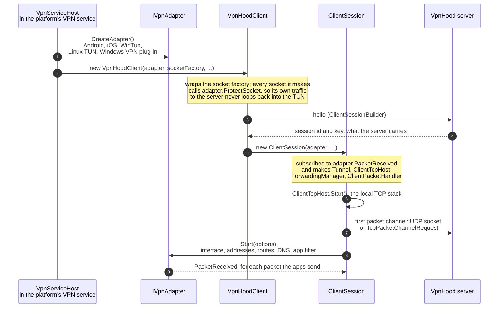
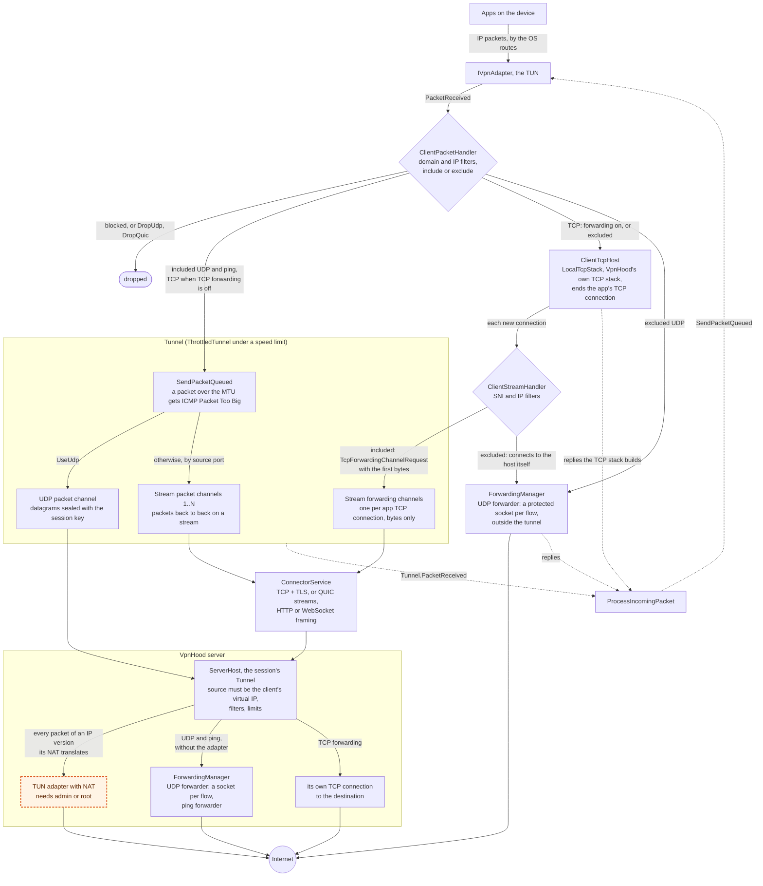

# How the VPN Engine Works

The VPN engine runs in the VPN service ([the two halves](client-architecture.md#the-two-halves)). It takes
every packet the device's apps send, decides where each one goes, and carries it to the VPN server in a
tunnel. This page shows how the engine gets its adapter and starts, then how a packet travels between the
adapter and the tunnel.

## How the engine gets its adapter

1. **The engine never makes the adapter.** The platform's VPN service makes it and hands it to
   `VpnHoodClient`. To the engine an adapter is a packet pipe: `PacketReceived` brings each packet the apps
   send, and `SendPacketQueued` writes the replies back. So one engine runs on every platform, and the tests
   run it on a `NullVpnAdapter`.
2. **The engine's own traffic stays out of the adapter.** The client wraps the socket factory, so each
   socket it opens calls the adapter's `ProtectSocket`, and its traffic to the server never loops back into
   the tunnel.
3. **The adapter starts last**, once the session has its local TCP stack running and its first packet
   channel to the server.

## How a packet travels

1. **`ClientPacketHandler` sends each packet one of three ways**: into the tunnel, to the local TCP stack,
   or around the tunnel through `ForwardingManager`, for what split tunneling excludes; its UDP forwarder
   gives each excluded UDP flow a socket of its own. DNS goes through the tunnel by default, and pings always
   do.
2. **TCP takes one of two routes.** It goes as packets in the tunnel when the server's adapter can NAT its
   IP version. Otherwise it goes by TCP forwarding: the engine's own TCP stack ends the app's connection,
   only its bytes cross the tunnel, and the server opens its own connection to the destination. The domain
   filter always uses forwarding, as it reads the server name (SNI) in each connection's TLS hello.
3. **Only the server's TUN adapter needs admin or root** (marked in the drawing): it makes a network
   interface and the NAT that translates the clients' packets. A server without it still serves every app:
   its UDP forwarder sends UDP through a socket for each flow, its ping forwarder sends the pings, and TCP
   goes by TCP forwarding.
4. **The channel protocol picks the tunnel's transport**: one UDP channel, or stream channels over TLS or
   QUIC. A packet's channel follows its source port, so each flow stays on one channel, in order.
5. **Replies come back three ways**, from the tunnel, the TCP stack and the bypass, and all go back into the
   adapter.

## See also

- [VpnHood Client Architecture](client-architecture.md) — the layers around the engine, and the VPN service it runs in
- [How a VpnHood App Starts](app-startup.md) — what starts the app, and with it the VPN service
- [What Happens on Connect](connect.md) — the engine's part in a connect: finding a server, the hello, the adapter
